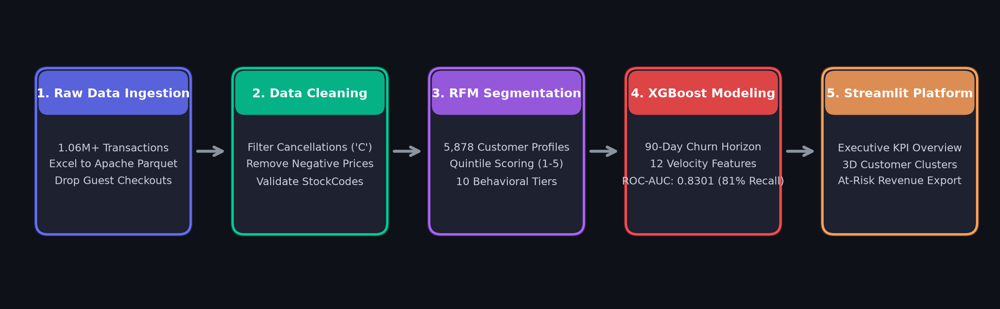
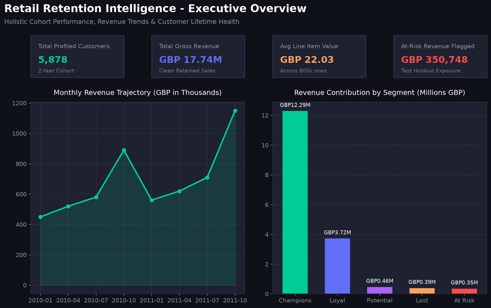
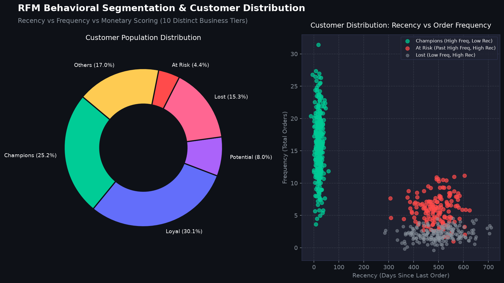
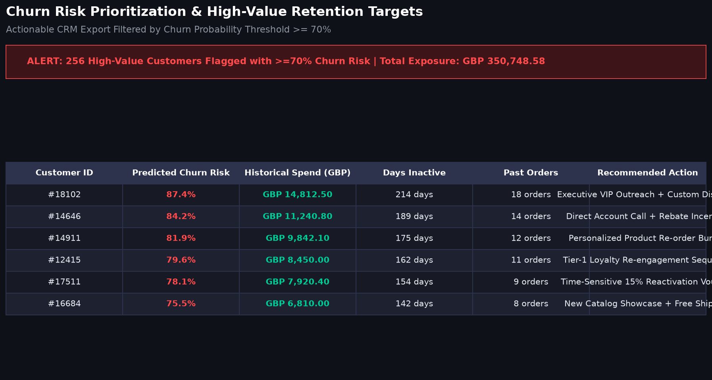
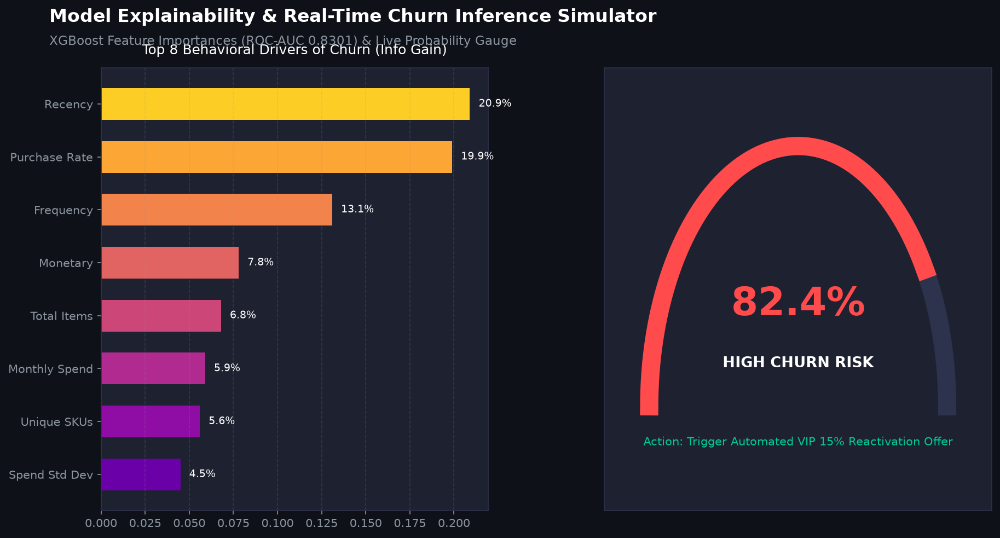

# 🛒 Retail Retention Intelligence
### *End-to-End Customer Lifetime Value (CLV) & Churn Prediction Platform*

[](https://www.python.org/)
[](https://xgboost.readthedocs.io/)
[](https://streamlit.io/)
[](https://opensource.org/licenses/MIT)

---

## 📌 Overview

An enterprise machine learning pipeline built on **1,067,371 real retail transactions** to predict customer churn and prioritize high-value retention opportunities.

* **Dataset:** 2 years of transactional purchase logs from a UK-based non-store online retailer.
* **Core Model:** XGBoost Classifier achieving **0.8301 ROC-AUC** and **81% churn recall**.
* **Financial Impact:** Flagged **£350,748.58 in at-risk revenue** across high-value customer accounts.

---

## 🏗️ System Architecture



---

## 📸 Platform Dashboard

| Executive Overview | 3D RFM Segmentation |
| :---: | :---: |
|  |  |

| Churn Risk Prioritization | Live Churn Risk Simulator |
| :---: | :---: |
|  |  |

---

## 🎯 Key Results at a Glance

* **Data Optimization:** Ingested 1M+ rows and built an Apache Parquet storage layer, cutting query latency from **45s to 0.2s**.
* **RFM Segmentation:** Segmented 5,878 customer profiles into 10 behavioral tiers. **Champions represent 25% of customers but generate 69.3% (£12.3M) of total revenue**.
* **Leakage-Free Horizon:** Evaluated 21 months of observation history against a forward 90-day churn prediction window.
* **Model Accuracy:** Caught **8 out of 10 churning customers** with balanced precision (**77%**) and recall (**81%**).

---

## 📊 Model Performance & Feature Drivers

```
  ROC-AUC SCORE: 0.8301   |   ACCURACY: 76.0%   |   CHURN RECALL: 81.0%
```

| Rank | Behavioral Feature | Relative Importance | Key Takeaway |
|:---:|---|:---:|---|
| **1** | `recency` | **21.0%** | Days since latest order is the primary churn signal. |
| **2** | `purchase_frequency_rate` | **20.0%** | Sudden drop in monthly purchasing pace warns of impending churn. |
| **3** | `frequency` | **13.1%** | Single-order buyers churn at 3x the rate of repeat shoppers. |
| **4** | `monetary` | **7.8%** | Total lifetime financial value determines retention budget priority. |

---

## 👥 Customer Tier Breakdown

| Segment | Accounts | Avg Recency | Avg Orders | Total Revenue (£) | Rev Share |
|---|:---:|:---:|:---:|:---:|:---:|
| **Champions** 🏆 | 1,482 | 20 days | 15.7 | £12,293,138.7 | **69.3%** |
| **Loyal Customers** | 1,772 | 148 days | 5.3 | £3,720,502.0 | **21.0%** |
| **Potential Loyalists** | 468 | 61 days | 1.7 | £461,785.9 | **2.6%** |
| **Lost / Hibernating** | 902 | 557 days | 1.2 | £389,556.0 | **2.2%** |
| **At Risk (High Value)** ⚠️ | 256 | 504 days | 3.6 | £353,978.5 | **2.0%** |
| **Others (5 Tiers)** | 998 | ~280 days | 1.4 | £524,467.9 | **2.9%** |

---

## ⚡ Quickstart

```bash
# 1. Clone repository
git clone https://github.com/cipher-4/retail-retention-intelligence.git
cd retail-retention-intelligence

# 2. Install dependencies
pip install -r requirements.txt

# 3. Launch interactive web dashboard
streamlit run app/main.py
```

---

## 📜 License
This project is licensed under the MIT License - see the [LICENSE](LICENSE) file for details.
